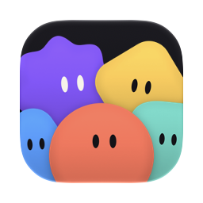
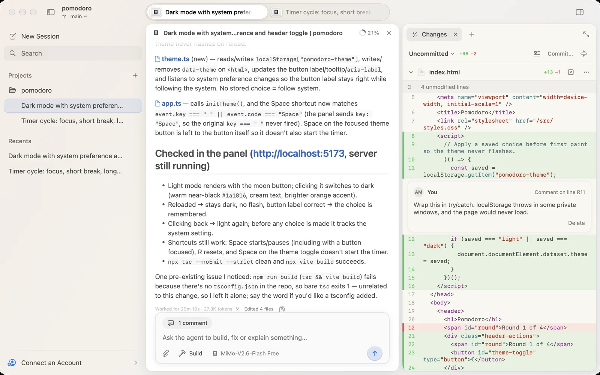

<p align="center"></p>

<h1 align="center">Kuvo Code</h1>

<p align="center"><strong>Any model. One native harness.</strong></p>

<p align="center">
  <a href="https://github.com/serhatandic/kuvo-code/actions/workflows/ci.yml"></a>
  <a href="https://github.com/serhatandic/kuvo-code/releases"></a>
  <a href="LICENSE"></a>
</p>

<picture>
  <source media="(prefers-color-scheme: dark)" srcset="docs/images/screenshot-dark.webp">
  
</picture>

Kuvo Code is a native macOS harness for coding agents that works with any
model. Its engine is [opencode](https://github.com/anomalyco/opencode),
unmodified; Kuvo Code is the interface, written in SwiftUI: sessions by
project, changes you review and comment on like a pull request, and a side
panel with files, terminals and a browser the agent can use too.

Use any model. Sign in with a subscription you already have, add an API key,
or start with free models that need no account.

[Download for macOS](https://github.com/serhatandic/kuvo-code/releases/latest/download/KuvoCode.dmg)
· [Docs](https://kuvo.run/code/docs/)
· [Report a bug](https://github.com/serhatandic/kuvo-code/issues/new/choose)
· [Contact](mailto:info@kuvo.run)
· [Build from source](#build-from-source)

## Features

- **Any model.** Claude, GPT, Gemini, open models through OpenRouter,
  and the rest of opencode's providers. Pick the model and effort for
  each message.
- **Review like a pull request.** The Changes tab shows the project's
  uncommitted changes from git, with unchanged lines folded and pictures shown
  before and after. Comment on a line, and the comment goes to the agent with
  your next message.
- **Files, terminals and a browser.** The side panel holds them as tabs: the
  project's files with code highlighted and Markdown rendered, your shell in
  the project folder, and a web browser.
- **Browsing for the agent, with any model.** The agent opens pages in the
  panel's browser, reads them, clicks, types and scrolls, and you see every
  step.
- **Sessions on your servers.** Open projects on a Linux machine you reach
  with SSH, like a home server or a VPS, next to your Mac's. Their sessions,
  changes, files, terminals and the agent's browser run there, and the panel
  shows that browser live.
- **Attach anything.** Drop, paste or pick files of any kind.
- **Plans and spend in the menu bar.** Limits with pace and reset times, and
  spend, for the accounts you connect: GitHub Copilot, ChatGPT (Codex),
  OpenCode, OpenRouter and Z.ai.
- **A native app.** SwiftUI and AppKit with Liquid Glass. No Electron.

## Getting started

Kuvo Code needs a Mac with Apple silicon and macOS 26 or later.

1. [Download KuvoCode.dmg](https://github.com/serhatandic/kuvo-code/releases/latest/download/KuvoCode.dmg),
   open it, and drag Kuvo Code onto the Applications folder.
2. Open it. The first launch downloads the opencode engine and checks it
   before it runs.
3. Open **Accounts** (⇧⌘K) to sign in or add an API key, or start with the
   free models.
4. Open a project folder (⌘O) and tell the agent what to build. It can read,
   edit and run things there. To approve each edit and command first, choose
   **Ask First** in the composer's mode menu.

The [docs](https://kuvo.run/code/docs/) cover sessions, reviewing changes, the
side panel and the usage menu.

## How it works

- **The engine is opencode itself**: the official, signed `@opencode/cli`
  binary, unmodified. Kuvo Code downloads the version it's written against,
  checks its checksum and its code signature, and keeps it in
  `~/Library/Application Support/run.kuvo.code/engine`.
- **Each launch runs a private server**, `opencode serve --stdio --port 0`
  with a random password, which exits when the app does. The app talks to its
  HTTP API and follows its event stream to show live transcripts.
- **Its data is kept apart** from any opencode you've installed. Sessions,
  accounts and settings live in
  `~/Library/Application Support/run.kuvo.code/opencode`. The commands the
  agent runs still get your own folders (`~/.config` and the like) back,
  through a small plugin in the engine's `plugins` folder, so tools such as
  `gh` find their sign-ins.
- **The coding agents you already have** (Claude Code, Codex, Cursor, Grok,
  Antigravity) run beside the engine, each as its maker built it and signed in
  as you: a small bridge of Kuvo Code's own (`Agents/`, run by the engine's
  Bun) drives them through the Claude Agent SDK and your `claude`, Codex's
  app-server, Cursor's SDK, and the Agent Client Protocol for Grok and
  Antigravity, and answers the app in the engine's own API. A session there can
  move between agents (the next one gets the conversation as a handover) and
  run the engine's models, and Custom Auto runs down your own lists of models as
  each reaches its limit or fails. What it keeps is in
  `~/Library/Application Support/run.kuvo.code/agents`. Each machine runs the
  same bridge beside its engine, with the agents installed and signed in there
  (in `~/.kuvo-code/agents`), and there it also runs the group chats whose bots
  all live on that machine (in `~/.kuvo-code/groups`).
- **On a machine you add**, Kuvo Code reaches it with `ssh` and your keys. It
  sends the same engine version's Linux build, downloaded and checked on the
  Mac, to `~/.kuvo-code` there, runs it on the machine's localhost only, and
  talks to it through an SSH tunnel, which closes with the app however it ends.
  The engine runs on its own, with or without
  the app, so a task, a bot's wake-ups and group chats carry on while the Mac is
  off, and it starts again by itself after a crash; after the machine restarts,
  a line in your crontab there starts it again as the app last started it. Each
  machine keeps its own settings and integrations' keys, in files only you can
  read, never in its environment. Your Mac and machines reach each other
  through Kuvo Code's relay, end to end encrypted, so agents on one write to
  agents on another with the Mac off too.
- **The agent's browser tools** are served by the app on `127.0.0.1`, with a
  new port and token each launch. They read a page the way
  [browser-use](https://github.com/browser-use/browser-use) does, as numbered
  interactive elements, and every step happens in the browser you see.
- **On a machine, the browser** is Chrome for Testing, run headless,
  sent from the Mac to `~/.kuvo-code/browser` with every library and font it
  needs (Enterprise Linux 8 builds, pinned with their checksums by
  `scripts/browser-runtime.py`), so nothing is installed on the system. A
  helper the engine's own runtime runs (`kuvo-browser.js`) keeps it going,
  drives it over a pipe rather than a port, gives the engine the same tools,
  and streams the page to the panel over SSH.
- **Updates** come through [Sparkle](https://sparkle-project.org), signed,
  from this repository's releases, and its betas (prereleases) to copies with
  Get beta updates on. Releases are signed with a Developer ID and notarized by
  Apple.
- **The usage menu** is UsageKit, our fork of
  [OpenUsage](https://github.com/robinebers/openusage) by Robin Ebers. It
  follows the accounts you connect in Kuvo Code and reads their usage with
  them; Codex's comes from the Codex app's own sign-in on your Mac. It renews
  sign-ins when they expire, as those tools would.

## Build from source

You need Xcode 27 or later.

```sh
git clone https://github.com/serhatandic/kuvo-code.git
cd kuvo-code
open KuvoCode.xcodeproj
```

Run the **KuvoCode** scheme. See [CONTRIBUTING.md](CONTRIBUTING.md) for
building from Terminal, tests, and the debug launch variables.

## Contributing and security

Bug reports and focused pull requests are welcome; read
[CONTRIBUTING.md](CONTRIBUTING.md) first. Please report vulnerabilities
privately, as described in the [security policy](SECURITY.md). For anything
else, write to [info@kuvo.run](mailto:info@kuvo.run).

## License

Kuvo Code is source-available under the
[PolyForm Noncommercial License 1.0.0](LICENSE). You may use, study, modify,
and redistribute it for permitted noncommercial purposes. Commercial use,
including monetizing a fork or derivative, requires a separate written license
from the copyright holder: write to [info@kuvo.run](mailto:info@kuvo.run). See [NOTICE](NOTICE) for the required copyright
notice and [THIRD_PARTY_LICENSES.txt](THIRD_PARTY_LICENSES.txt) for the
licenses of included dependencies.

Contributions are welcome under the terms in [CONTRIBUTING.md](CONTRIBUTING.md)
and the [Contributor License Agreement](CONTRIBUTOR_LICENSE_AGREEMENT.md).
Those terms let the project owner continue to offer commercial licenses.

Kuvo Code is an independent project. It isn't affiliated with opencode or with
the companies whose models and tools it works with.
